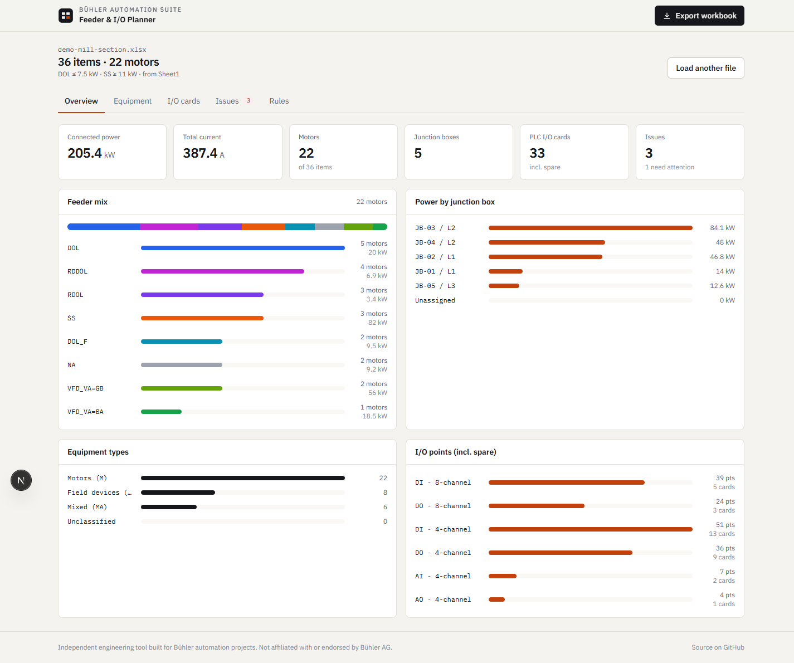
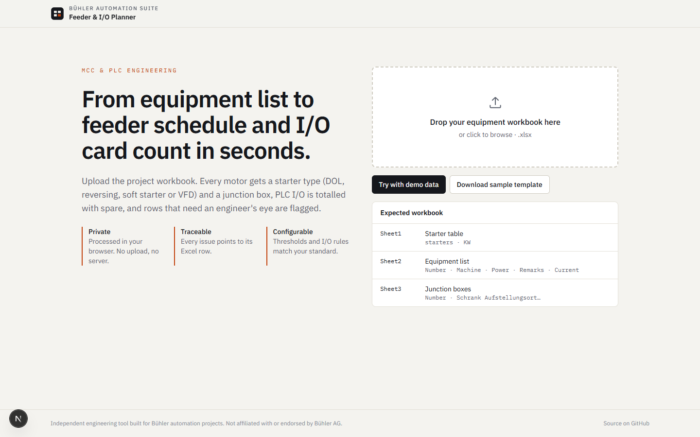
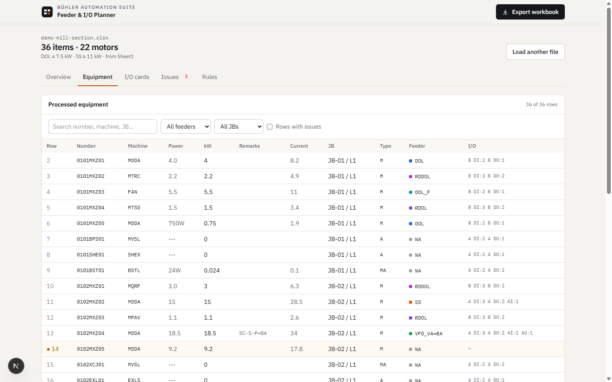
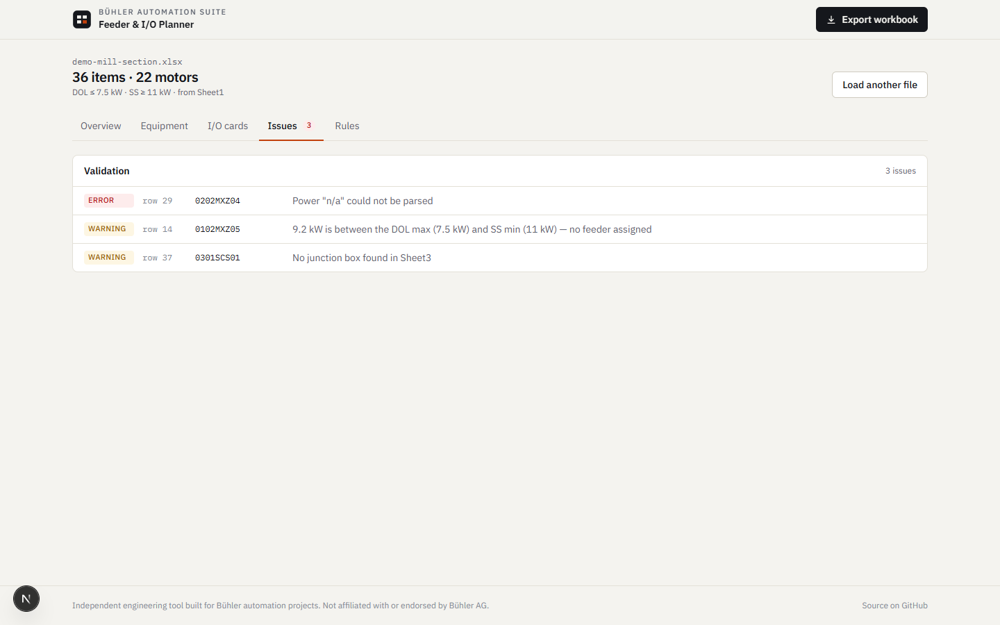
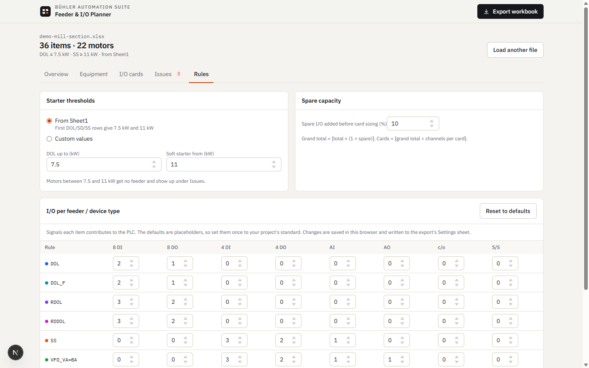
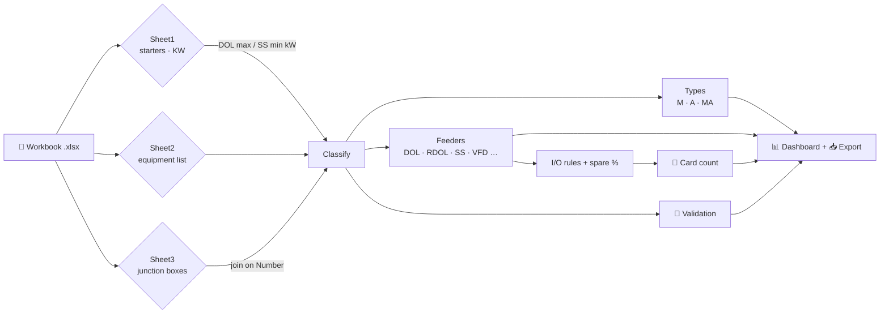

<div align="center">

# ⚡ Feeder & I/O Planner

### Bühler Automation Suite

**Turn an equipment list into an MCC feeder schedule, junction-box mapping and PLC I/O card count in seconds, entirely in your browser.**

[](https://buhler-feeder-planner.vercel.app)




</div>

---

## Why it exists

On a milling or processing plant project, the electrical team gets a long equipment list and has to answer the same questions every time:

- Which starter does each motor need: DOL, reversing, soft starter or VFD?
- Which junction box is each item wired to?
- How many PLC I/O cards should be ordered, spare included?

This tool started as an internal Streamlit script for Bühler automation projects. It has been rebuilt as a fast, polished web app that anyone can open in a browser, with no Python install and no server.

## ✨ Features

| | Feature | What you get |
|---|---|---|
| 🔌 | **Feeder assignment** | Every motor (`…MXZ..`) becomes **DOL**, **DOL_F**, **RDOL**, **RDDOL**, **SS** or **VFD**, based on its kW, machine code and remarks |
| 📦 | **Junction-box mapping** | Equipment is joined to its JB from Sheet3 |
| 🧮 | **I/O card sizing** | Editable I/O points per feeder type, plus spare %. Cards are rounded up per channel count |
| 📊 | **Dashboard** | Connected kW, total current, feeder mix, power per JB and I/O points at a glance |
| 🔎 | **Equipment grid** | Search, filter by feeder or JB, or show only rows with problems |
| 🚩 | **Validation** | Unparseable power, motors that fall between thresholds and missing JBs are each listed with their **Excel row number** |
| ⚙️ | **Configurable rules** | Override the DOL and soft-starter thresholds. Settings persist in your browser |
| 📥 | **One-click export** | A workbook with **Processed**, **IO Summary**, **Issues** and **Settings** sheets |
| 🔒 | **Private by design** | The file is parsed locally with SheetJS. Nothing is uploaded |
| 📱 | **Responsive** | Works on desktop and phone, in light and dark mode |

## 🖼️ Screenshots

<table>
  <tr>
    <td width="50%"><p align="center"><b>Upload</b>: drop a workbook, try the demo or grab the template</p></td>
    <td width="50%"><p align="center"><b>Equipment</b>: every row with its kW, JB, type, feeder and I/O</p></td>
  </tr>
  <tr>
    <td width="50%"><p align="center"><b>Issues</b>: problems you can trace back to an Excel row</p></td>
    <td width="50%"><p align="center"><b>Rules</b>: thresholds, spare and I/O per feeder</p></td>
  </tr>
</table>

## 🔄 How it works



### Feeder rules (motors only)

| Condition | Feeder |
|---|---|
| Remarks `SC-S-P=BA` | `VFD_VA=BA` |
| Remarks `SC-S-P`, `SC-S-M=BM`, `SC-S-P=BM` | `VFD_VA=GB` |
| kW ≤ DOL max, machine `MTRC` / `MTRA` / `MQRH` / `MQRF` | `RDDOL` |
| kW ≤ DOL max, machine `MTSD` / `MPAV` / `MPAW` / `MPAU` | `RDOL` |
| kW ≤ DOL max, machine `FAN` | `DOL_F` |
| kW ≤ DOL max, any other machine | `DOL` |
| kW ≥ SS min | `SS` |
| Between the two thresholds | flagged ⚠️ |

## 📋 Input workbook

| Sheet | Required columns |
|---|---|
| `Sheet1` | `starters`, `KW`. The first two DOL/SD/SS rows set the thresholds |
| `Sheet2` | `Number`, `Machine`, `Power`, `Remarks`, `Current` |
| `Sheet3` | `Number`, `Schrank Aufstellungsort Feldkasten Stockwerk` |

`Power` accepts `7.5`, `7,5`, `7.5kW`, `750W`, `750VA` and `---`.

> 💡 No file at hand? Click **Try with demo data** or **Download sample template** in the app.

## 🚀 Getting started

```bash
git clone https://github.com/KRISH-exe-29/buhler-automation-app-.git
cd buhler-automation-app-
npm install
npm run dev        # → http://localhost:3000
```

| Command | Purpose |
|---|---|
| `npm run dev` | Local dev server |
| `npm test` | Engine rule tests (Vitest) |
| `npm run build` | Production build |
| `npm run lint` | ESLint |

## 🗂️ Project structure

```
src/
├── app/                 # Next.js layout, page, global styles
├── components/
│   ├── planner.tsx      # app shell, upload, tabs, I/O and issues views
│   ├── dashboard.tsx    # KPIs and charts
│   ├── data-grid.tsx    # searchable equipment table
│   └── rules-panel.tsx  # thresholds, spare and I/O rule editor
└── lib/
    ├── engine.ts        # pure classification and I/O logic
    ├── engine.test.ts   # 36 rule tests
    ├── excel.ts         # SheetJS read and export
    └── demo.ts          # demo dataset and sample template
```

## 🆕 What changed from the original Streamlit version

- ✅ I/O totals are **calculated from rules**. The original used hardcoded numbers.
- ✅ Cards are sized on the total **including spare**.
- ✅ `7.5kW` and decimal commas parse correctly.
- ✅ Motors with no feeder are **flagged** instead of silently showing `NA`.
- ✅ It deploys as a static site on Vercel, with no Python runtime needed.

---

<div align="center">

Built by **[Krishna Raju](https://github.com/KRISH-exe-29)** · Deployed on **[Vercel](https://buhler-feeder-planner.vercel.app)**

<sub>Independent engineering tool built for Bühler automation projects. Not affiliated with or endorsed by Bühler AG.</sub>

</div>
